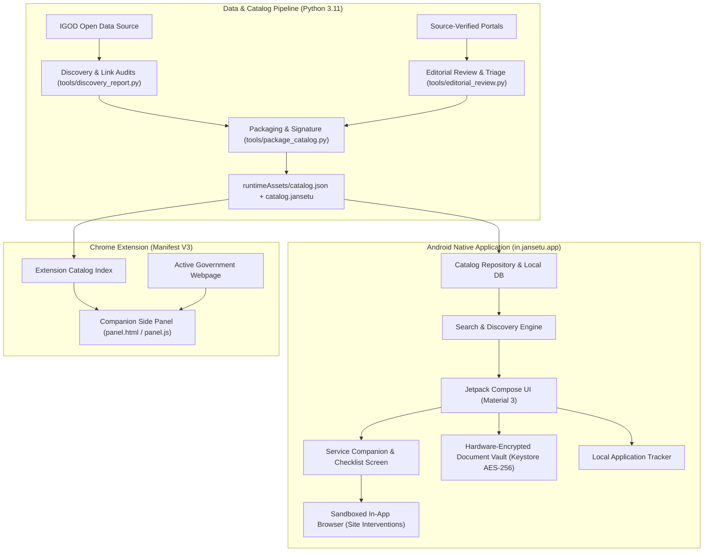
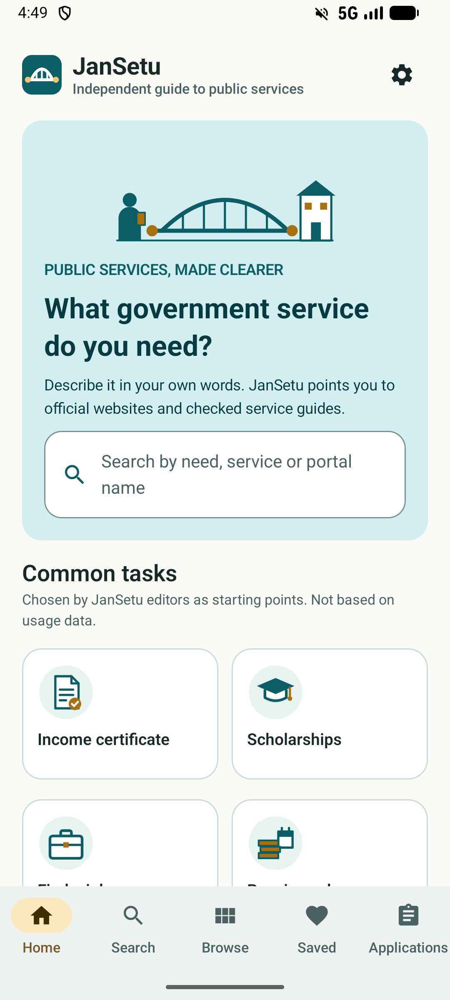
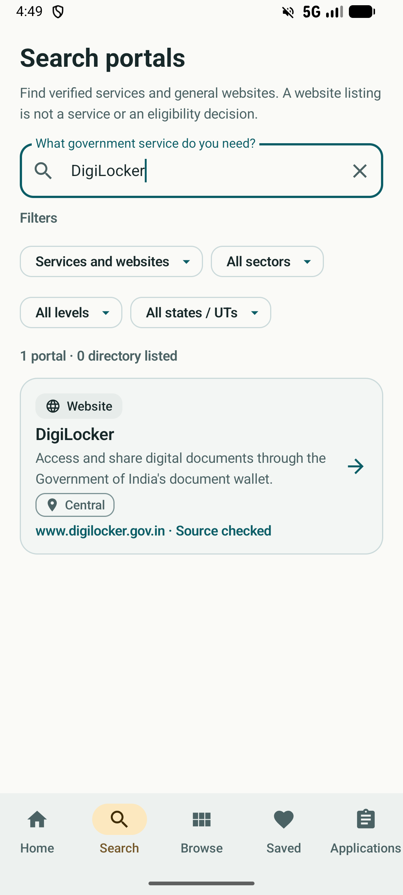
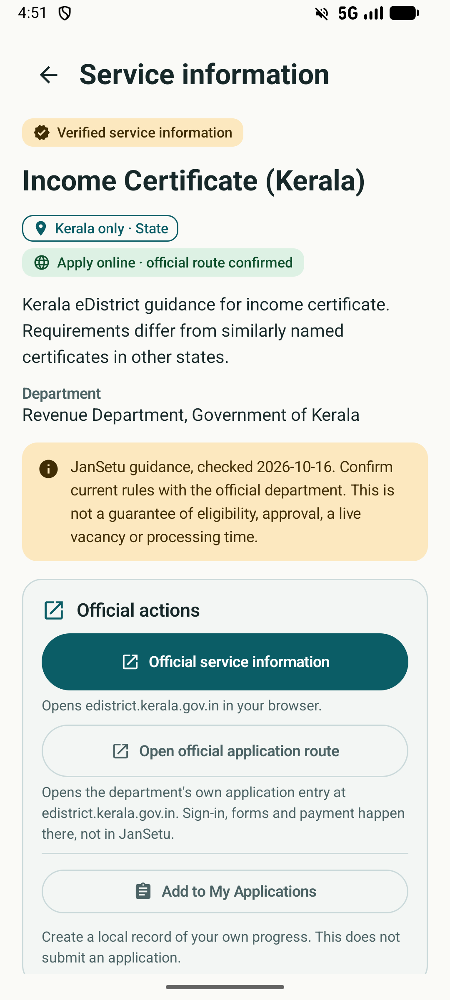
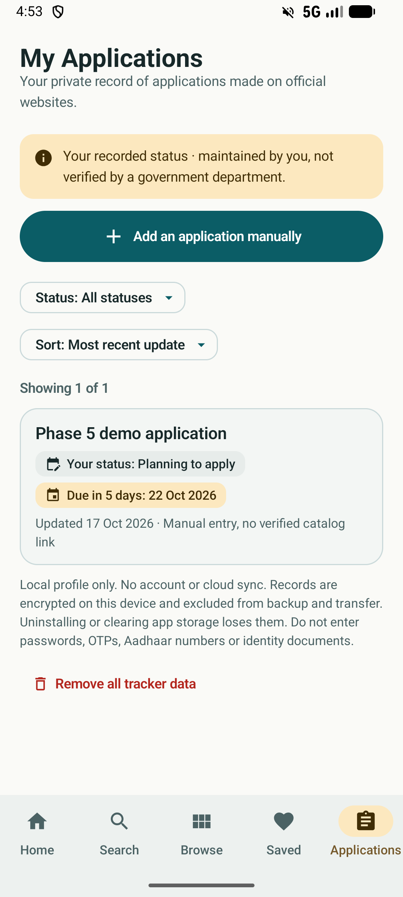
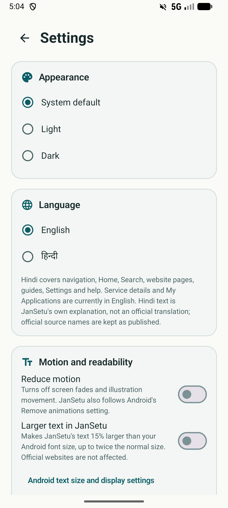
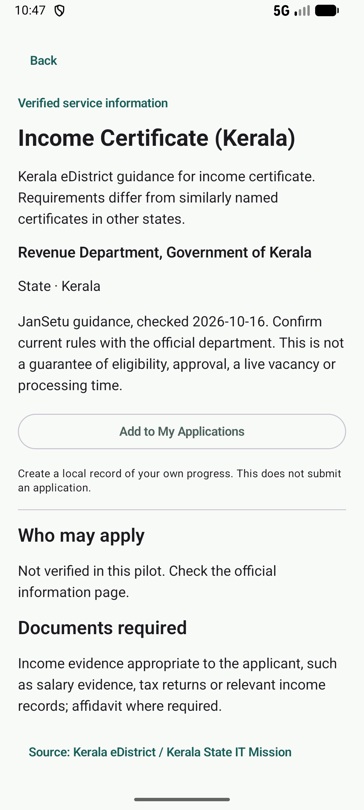

# JanSetu (जनसेतु)

<p align="center">
  
</p>

<p align="center">
  <strong>Unified Citizen Access Platform for Indian Public Services</strong><br />
  <em>An Android-first, privacy-respecting portal directory, plain-language service companion, and verified catalog pipeline.</em>
</p>

<p align="center">
  
  
  
  
  
  
  
</p>

---

> [!IMPORTANT]
> **Legal & Civic Disclaimer**: JanSetu is an independent civic software project and is **not** an official application of the Government of India or the National Informatics Centre (NIC). It serves as an independent, transparent discovery index and citizen companion. Official portal listings are attributed to their respective statutory departments, and directory listings draw from publicly available India Government Open Data (IGOD) records. Formal reproduction licensing remains ongoing prior to public distribution.

---

## 🏛️ Executive Overview

Navigating Indian government digital services often requires citizens to traverse thousands of fragmented portals across union, state, and local administrative tiers. **JanSetu** bridges this gap by providing:

1. **Intelligent Service Discovery**: Search across **7,347+ government websites** and **52 deeply reviewed citizen services** (across 19 functional categories) categorized by practical citizen intent (e.g., *apply for voter card*, *verify land record*, *check scholarship eligibility*).
2. **Citizen Companion**: Clear, plain-language summaries in English and Hindi, actionable step-by-step checklists, explicit eligibility rules, and authenticated links directly to official government portals.
3. **Hardware-Encrypted Document Vault (Phase 7)**: Encrypted local storage (AES-256-GCM via Android Keystore) for identity cards, marksheets, and income certificates. Files never leave the device and are never uploaded to any remote server.
4. **Sandboxed In-App Web Companion**: Secure in-app browsing with automated accessibility interventions, viewport adjustments, and explicit boundary warnings when navigating external portals.
5. **Offline-First Architecture**: Fully functional search and catalog browsing without internet access, with support for cryptographically signed `.jansetu` runtime catalog updates.
6. **Cross-Platform Companion Extension**: Manifest V3 browser extension for desktop Chrome/Chromium, delivering contextual guidance while citizens interact with official portals.

---

## 📐 System Architecture



---

## 📸 Interface Checkpoints

| Home & Discovery | Search & Filter | Service Details |
| :---: | :---: | :---: |
|  |  |  |

| My Applications Tracker | Settings & Catalog Update | Document Vault |
| :---: | :---: | :---: |
|  |  |  |

---

## 📂 Repository Layout

```text
├── app/                          # Android application module
│   ├── src/main/java/in/jansetu/app/
│   │   ├── catalog/              # Offline catalog models, repository, search index
│   │   ├── documents/            # Encrypted Document Vault (Keystore AES-256-GCM)
│   │   ├── tracker/              # Local application tracking & status timeline
│   │   ├── ui/                   # Jetpack Compose UI (Theme, Screens, Components)
│   │   └── web/                  # In-app browser companion with intervention injection
│   ├── src/main/assets/          # Bundled compressed runtime catalog & schemas
│   └── src/test/                 # Unit & regression test suites
│
├── extension/                    # Chrome / Chromium companion extension (Manifest V3)
│   ├── manifest.json             # MV3 configuration & permissions
│   ├── panel.html / panel.js     # Side-panel guidance assistant
│   ├── background.js             # Service worker & navigation listener
│   └── catalog.json              # Bundled extension catalog snapshot
│
├── data/                         # Catalog data, schemas, and verification records
│   ├── services/                 # 52 source-reviewed service specifications
│   ├── localizations/            # Multi-language string tables (English & Hindi)
│   ├── website_enrichment/       # Reviewed portal claims, evidence index, and audits
│   ├── validation_reports/       # Phase-by-phase test outputs and UI audits
│   ├── collection/               # IGOD baselines, categorization, and health status
│   └── catalog.schema.json       # JSON Schema enforcing data integrity
│
├── tools/                        # Python toolchain & automated pipeline
│   ├── package_catalog.py        # Compiles, validates, and signs runtime catalogs
│   ├── check_catalog.py          # Verifies schema compliance and catalog integrity
│   ├── audit_links.py            # Automated link health & SSL verification
│   ├── editorial_review.py       # Review queue & provenance management
│   └── requirements.txt          # Python dependencies
│
└── docs/                         # Specifications, roadmaps, and compliance reports
    ├── ARCHITECTURE.md           # Deep architectural breakdown
    ├── CATALOG_COVERAGE.md       # Up-to-date portal & service count reports
    ├── JANSETU_MASTER_ROADMAP.md # Multi-phase development tracking
    └── PHASE7_DOCUMENT_VAULT.md  # Cryptographic specification for documents
```

---

## 🚀 Getting Started & Build Guide

### Prerequisites

- **Android Development**: Android Studio (Ladybug 2024.2+ or Meerkat), JDK 17, Android SDK Platform 36, Build Tools 35.0.0+.
- **Python Pipeline**: Python 3.10+ (tested on Python 3.11).
- **Extension Testing**: Node.js 18+ and Google Chrome / Chromium.

### 1. Build the Android Application

```powershell
# Clone the repository
git clone https://github.com/Utkarsh151-glitch/JanSetu.git
cd JanSetu

# Install python dependencies for catalog generation
python -m pip install -r tools/requirements.txt

# Run unit tests and assemble the debug APK
./gradlew.bat :app:testDebugUnitTest :app:assembleDebug

# Linux / macOS:
# ./gradlew :app:testDebugUnitTest :app:assembleDebug
```
The compiled debug APK is located at `app/build/outputs/apk/debug/app-debug.apk`.

### 2. Verify Catalog Integrity & Test Pipeline

```powershell
# Run the automated catalog integrity and schema check
python tools/check_catalog.py

# Run unit test suites across all tool components
python -m unittest discover -s tools -p "test_*.py"

# Generate fresh catalog coverage documentation
python tools/catalog_pipeline.py report
```

### 3. Load the Chrome Companion Extension

1. Open Google Chrome and navigate to `chrome://extensions/`.
2. Enable **Developer mode** via the toggle switch in the upper-right corner.
3. Click **Load unpacked** and select the `extension/` directory from this repository.
4. Open any Indian government website (e.g., `nvsp.in`, `incometax.gov.in`) and open the JanSetu side panel to view contextual service instructions.

---

## 🔒 Privacy, Security & Cryptography

JanSetu is designed from first principles with a zero-trust citizen privacy model:

- **Zero Network Telemetry**: The application contains no analytics SDKs, no advertising trackers, and no background reporting clients.
- **Hardware-Backed Cryptography**: The Document Vault (Phase 7) generates an AES-256-GCM symmetric key inside the device's hardware-backed **Android Keystore**. Files stored in the vault are encrypted at rest and excluded from Android cloud backups (`allowBackup=false`).
- **Strict Storage Boundaries**: The application never requests unnecessary broad storage permissions (`MANAGE_EXTERNAL_STORAGE`). It interacts solely through Android's Storage Access Framework (SAF) for explicit user-selected file imports.
- **Signed Catalog Updates**: Offline catalog updates are packaged with cryptographic signatures (`.jansetu` format), preventing tampering or unauthorized modification of directory links.

---

## 📊 Development Phases & Verification Status

| Phase | Milestone Name | Status | Key Deliverable |
| :--- | :--- | :---: | :--- |
| **Phase 1** | Foundation & IGOD Ingestion | ✅ Passed | 7,347+ government websites crawled, deduplicated, and attributed |
| **Phase 2** | Discovery & Taxonomy Classification | ✅ Passed | 19 functional citizen categories, search indexing, and provenance ledger |
| **Phase 3A** | Search & Discovery UI | ✅ Passed | Jetpack Compose search engine with debounced bilingual query evaluation |
| **Phase 3B** | Application Tracker | ✅ Passed | Offline status tracker with step checklists and reminders |
| **Phase 3C** | Coverage Matrix & Verification | ✅ Passed | 52 source-reviewed high-impact services with eligibility & document trees |
| **Phase 4** | Quality Hardening | ✅ Passed | Edge-case validation, offline fallback verification, link health audits |
| **Phase 5** | Design System & Material 3 Redesign | ✅ Passed | Modern UI refresh, accessible typography, dynamic color support |
| **Phase 6A-D** | Catalog Information Quality & Reconciliation | ✅ Passed | Editorial review workflows, claim verification, snapshot auditing |
| **Phase 7** | Encrypted Document Vault | ✅ Passed | Keystore AES-256 document encryption, sandboxed SAF export |
| **Phase 8** | Account Architecture Boundary | 📋 Proposed | Strict architectural isolation: zero unnecessary cloud accounts |
| **Phase 9-16** | Ecosystem & Production Hardening | 🔄 In Progress | Multi-state coverage expansion, signed catalog release automation |

Complete execution logs, audit artifacts, and verification matrices can be inspected in the [`docs/`](docs/) directory.

---

## 🤝 Contributing

We welcome community contributions, particularly in the following areas:
- **Service Verification**: Reviewing and submitting verified document requirements and eligibility criteria for state-level citizen services.
- **Accessibility & Interventions**: Proposing scoped CSS/JS readability interventions for high-traffic official portals.
- **Localizations**: Expanding Indian language translations (beyond English and Hindi).

Please ensure all proposed service additions include direct official government citations. Pull requests modifying catalogs without verified provenance will not be merged.

---

## 📜 License & Acknowledgments

- **Application Code**: Licensed under the MIT License.
- **Portal Attribution**: Government portal names, links, and public records remain the intellectual property and copyright of their respective ministries, departments, and statutory bodies of the Government of India.
- **Author**: Developed with dedication to citizen empowerment by [Utkarsh Vaibhav](https://github.com/Utkarsh151-glitch).
